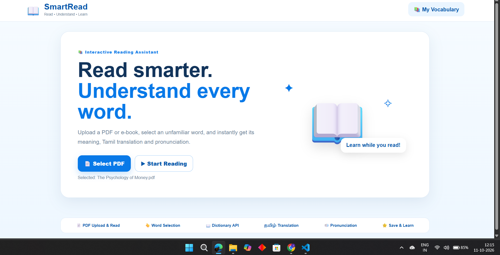
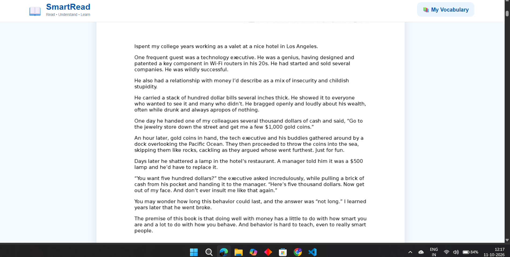
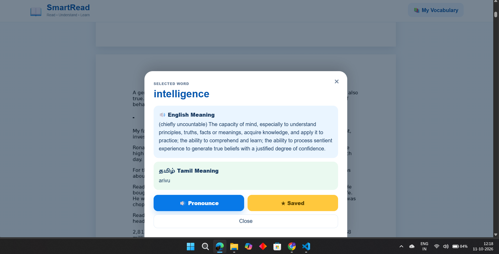
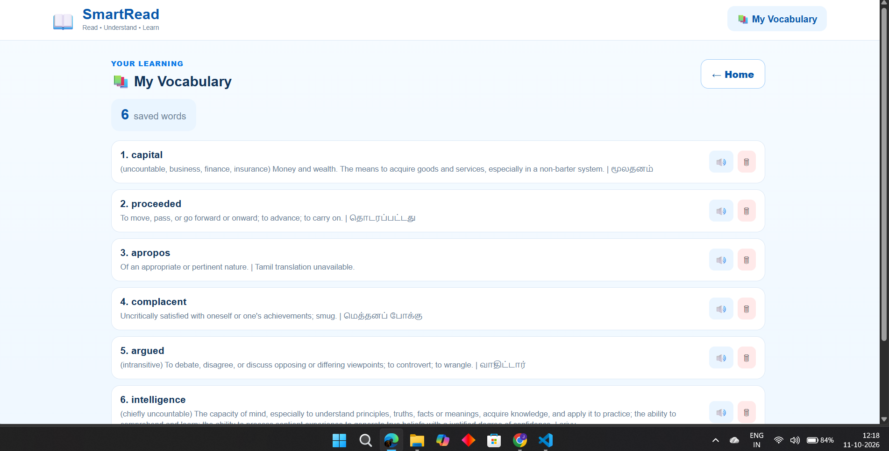

# 📖 SmartRead

**Read • Understand • Learn**

SmartRead is a web-based reading assistant for students and English learners. Upload a PDF, double-click (or double-tap) any word, and instantly see its English meaning, its Tamil translation and its pronunciation, without leaving the page. Words can be saved to a personal vocabulary list that stays on your device.

---

## Problem Statement

Students who read English e-books, PDFs and articles often meet unfamiliar words. Switching to a dictionary app or website breaks their concentration, and the new words are rarely written down, so they are forgotten. For Tamil-speaking learners, an English-only definition is often still hard to understand.

## Objectives

- Let users read their own PDF files inside the browser.
- Show the exact word the user selected, with its English and Tamil meaning, without interrupting reading.
- Provide pronunciation so learners hear the word as well as read it.
- Let learners save words and review them later.
- Work on both laptop and mobile browsers.
- Use only HTML, CSS and vanilla JavaScript, with no backend.

## Features

- **PDF upload and reading**: multi-page PDFs rendered with PDF.js, with an invisible text layer aligned to the page so selection is accurate.
- **Exact word selection**: double-click a word on desktop, double-tap on mobile, or drag-select on desktop. Multi-word selections are rejected, and words PDF.js splits across fragments are rejoined.
- **English dictionary**: definitions fetched live from a dictionary API, with an automatic fallback source if the first one is slow or down.
- **Tamil translation**: the selected word is translated to Tamil through a translation API.
- **Pronunciation**: the browser's built-in text-to-speech reads the word aloud.
- **Save vocabulary**: save words, see the saved count, replay pronunciation and delete words. Saved words survive page refreshes (localStorage).
- **Reliability**: request timeouts, a result cache for words already looked up, and friendly messages when a word is not found or an API is unavailable.
- **Responsive design**: works on desktop browsers and mobile screens, with touch-friendly buttons.

## Technologies Used

| Area | Technology |
|------|------------|
| Structure | HTML5 |
| Styling | CSS3 (responsive layout, CSS variables) |
| Logic | Vanilla JavaScript (ES6+) |
| PDF rendering and text layer | [PDF.js](https://mozilla.github.io/pdf.js/) 3.11.174 |
| Dictionary | [Free Dictionary API](https://dictionaryapi.dev/), fallback: [Datamuse API](https://www.datamuse.com/api/) |
| Tamil translation | [MyMemory Translation API](https://mymemory.translated.net/doc/spec.php) |
| Pronunciation | Web Speech API (`speechSynthesis`) |
| Storage | Browser `localStorage` |

## Project Structure

```
SmartRead/
│
├── index.html      # Page structure: home, reader, vocabulary, meaning popup
├── style.css       # Theme and responsive styles
├── script.js       # PDF rendering, word detection, APIs, vocabulary
├── README.md       # Project documentation
└── assets/
    └── sample-book.pdf   # Optional sample file for demos
```

## How to Run the Project

SmartRead needs no installation, but it should be opened through a local web server, not by double-clicking `index.html`. Browsers block some features on `file://` pages.

**Option 1: VS Code Live Server (recommended)**
1. Open the `SmartRead` folder in VS Code and choose **Trust** if asked.
2. Install the **Live Server** extension.
3. Right-click `index.html` and choose **Open with Live Server** (or click **Go Live**).
4. The browser opens at `http://127.0.0.1:5500`.

**Option 2: Python**
```bash
cd SmartRead
python -m http.server 5500
```
Then visit `http://localhost:5500`.

An internet connection is required for PDF.js, the dictionary, the translation and the fonts.

**Using the app**
1. Click **Select PDF** and choose a file, then click **Start Reading**.
2. Double-click (desktop) or double-tap (mobile) a word.
3. Read the meanings, tap **Pronounce**, or tap **Save Word**.
4. Open **My Vocabulary** to review or delete saved words.

## API Information

| Purpose | Service | Key needed | Notes |
|---------|---------|-----------|-------|
| English meaning | Free Dictionary API (`api.dictionaryapi.dev`) | No | Primary source |
| English meaning (fallback) | Datamuse (`api.datamuse.com`) | No | Used if the primary fails or times out |
| Tamil translation | MyMemory (`api.mymemory.translated.net`) | No | Machine translation, so meanings may be approximate |

These are free public services with usage limits. Requests time out after 8 seconds and results are cached to keep the number of calls low. If a service is unavailable, the app shows a clear message instead of freezing.

## Screenshots

### Home


### PDF Reader


### Word Meaning


### My Vocabulary


## Known Limitations

- Works with text-based PDFs only. Scanned PDFs (images) have no selectable text.
- Needs an internet connection for meanings, translation and PDF.js.
- Looks up single words, not phrases.
- Pronunciation quality depends on the voices installed in the user's browser.
- Saved words live in one browser's localStorage and are not shared between devices.

## Future Enhancements

- EPUB support
- Offline dictionary
- Multiple Indian languages
- AI-based contextual word explanations
- Vocabulary quizzes and flashcards
- Reading progress tracking
- User accounts and cloud synchronization

## Author

- **Name:** Janani L
- **Course:** B.E. CSE (Cyber Security)
- **College:** Shree Venkateshwara Hi-Tech Engineering College
- **GitHub:** [jananil683-byte](https://github.com/jananil683-byte)

---

*Small steps. Big progress.*